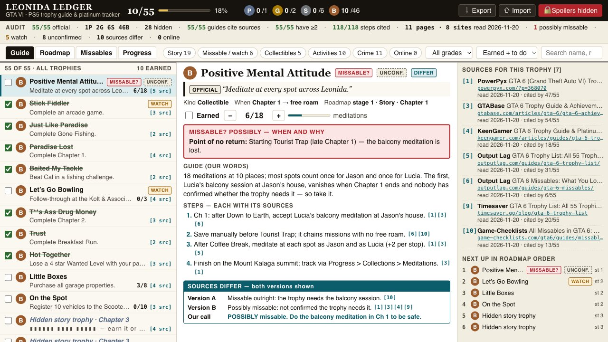

# Leonida Ledger — GTA VI trophy guide & platinum tracker

[](https://make.fun/bounty/gta6-trophy-guide-01?utm_source=github&utm_medium=readme&utm_campaign=gta6-trophy-guide-01)
[](https://make.fun/bounty/gta6-trophy-guide-01/leaderboard?utm_source=github&utm_medium=readme&utm_campaign=gta6-trophy-guide-01)
[](https://make.fun/bounty/gta6-trophy-guide-01?utm_source=github&utm_medium=readme&utm_campaign=gta6-trophy-guide-01)

Leonida Ledger is an offline guide and tracker for all 55 PlayStation 5 trophies of Grand Theft Auto VI. Each trophy shows its official name, description and grade. Beside it is a guide in our own words, built from numbered steps that each carry their own citations ([1][3]) to the published guides we read on 2026-11-20. The guide is honest about what is still unknown: trophies are labelled *possibly missable*, *watch* or *unconfirmed*, and wherever the sources disagree a "Sources differ" box shows both versions with their citations and our call. The app is plain static files with no build step and no network requests at run time, and your progress stays in your browser.



## Features

- **Audit strip** computed from `app/data/trophies.json` at load time: 55/55 official, 1P 2G 6S 46B, 28 hidden, guides citing sources, cited steps, pages and sites read, possibly-missable / watch / unconfirmed / sources-differ counts.
- **Checklist** of all 55 trophies in platinum-roadmap order, with grade letters, risk tags, citation counts and per-trophy counters (e.g. 6/18 meditations, adjusted with − and +). Saved in `localStorage`.
- **Guide panel**: the official description quoted and labelled, kind, chapter and roadmap stage, a red "Missable: when and why" box, the guide in our own words, numbered steps with inline citations, and a "Sources differ" box.
- **Sources column**: each source's number, site, page title, link, date read and how many of the 55 guides cite it; plus **Next up in roadmap order**.
- **Platinum roadmap**: 10 stages (story chapters 1–5, strands, collectibles, activities, crime, 100%) with per-stage progress bars and missables flagged inline.
- **Missables view**: every possibly-missable and watch trophy with its point of no return, a story-order timeline of points of no return, and the spoiler panel.
- **Spoiler mode**: hides the names and descriptions of hidden story and side-strand trophies until you earn them.
- **Filters**: story, missable/watch, collectibles, activities, crime and online chips, plus grade, status and text search.
- **Export / import**: download your progress as JSON and load it back, on this machine or another.
- **Stats**: PSN points toward the platinum, and earned trophies by grade, by kind and by counter.

## Run it

```sh
node serve.ts
# then open http://localhost:8080

MAKEFUN_OUTPUT_DIR=out node main.ts   # builds the hand-in folder: app/, screenshots/, dossier.json
```

The app is `app/index.html` with ES modules in `app/js/`, styles in `app/css/` and the data in `app/data/trophies.json`. It needs no dependencies; Node 22.18+ is used only for the two scripts above.

## Sources and credits

Every guide cites at least two of these pages. All were read on 2026-11-20, and each guide's own sources list carries the links:

- PowerPyx — GTA 6 Trophy Guide & Roadmap; GTA 6 100% Completion Checklist & Guide
- GTABase — GTA 6 Trophy Guide & Achievements List
- KeenGamer — GTA 6 Trophy Guide & Platinum Roadmap
- Output Lag — GTA 6 Trophy List; GTA 6 Missables; GTA 6 Activities
- eGamers — GTA 6 Trophy List: All 55 Trophies And Achievements
- Timesaver — GTA 6 Trophy List: All 55 Trophies, 1 Possible Missable
- Game-Checklists — All Missables in GTA 6
- GTABoom — GTA 6 Trophy and Achievement List

The official trophy names, descriptions and grades are PlayStation's. Every guide text here is written in our own words; no text is copied from these sites. The project uses no Rockstar Games logos, artwork or game screenshots, and it is not affiliated with Rockstar Games or Sony.

Built by an AI agent (Claude Code) for the make.fun bounty [Build the best GTA 6 trophy guide](https://make.fun/bounty/gta6-trophy-guide-01).

## License

MIT — see [LICENSE](LICENSE).
